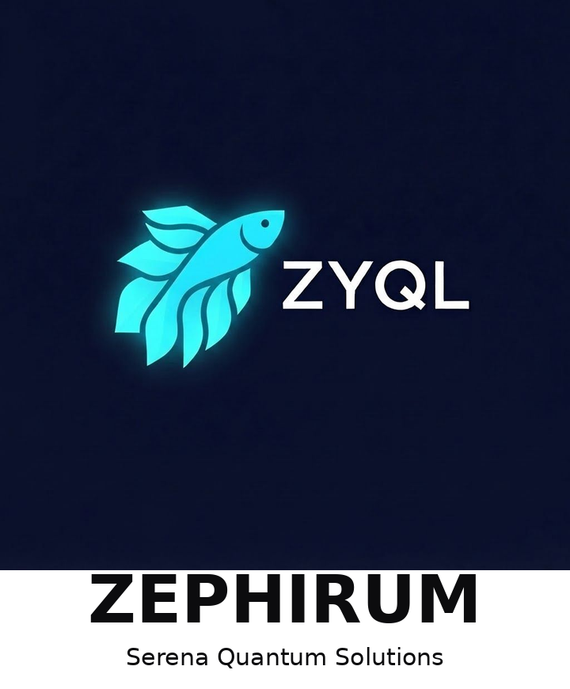

<h3 align="center">Infraestrutura de decisão quântica verificável</h3>

Linguagem &middot; decisão trivalente (1 / 0 / REFUSED) &middot; evidência estatística &middot; recibo verificável

<a href="https://serenasolutions.github.io/zephirum-lang/">documentação</a> &middot;
<a href="https://github.com/SerenaSolutions/zephirum-lang">repositório</a> &middot;
<a href="https://github.com/SerenaSolutions/zephirum-lang/blob/main/docs/SPEC_Z-QEA_v1.0.md">especificação Z-QEA v1.0</a> &middot;
<a href="https://github.com/SerenaSolutions/zephirum-lang/blob/main/SECURITY.md">segurança</a>

---

**ZEPHIRUM&trade;** é uma linguagem para computação quântica em que a decisão é um cidadão de primeira classe. O núcleo **ZYQL&trade;** devolve `1`, `0` ou `REFUSED`, e recusa quando a evidência não sustenta uma conclusão.

Toda alegação carrega recibo: selo SHA3-256, assinatura ML-DSA-44 e cadeia ancorada. Simulação é declarada simulação, e hardware é declarado hardware, com identificador de job.

| Camada | Estado |
|---|---|
| Núcleo trivalente, runtime, linguagem | implementado, com testes |
| Recibos (SHA3 + ML-DSA-44) e cadeia | implementado; sem certificação FIPS/CAVP |
| Experimentos em QPU | executados; validade externa pendente |
| Adoção institucional | não demonstrada |

Documentação, limites declarados e código em [zephirum-lang](https://github.com/SerenaSolutions/zephirum-lang).
